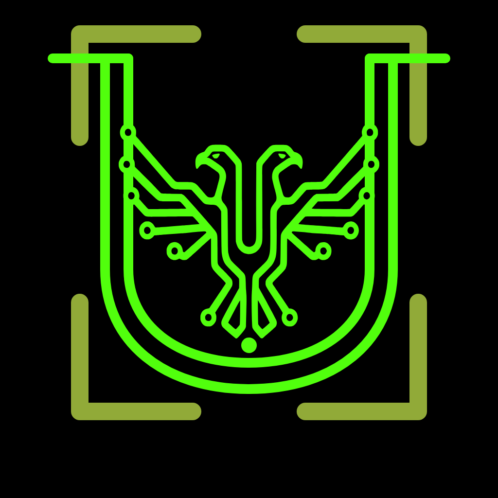

<p align="center">
  
</p>

# URMA Wire

**An experimental application built on the [URMA protocol](https://urma.rosint.org/spec/0.11/).**

Write public posts and replies, follow conversations, and manage your on-chain
identity from a desktop application. Wire signs records with your URMA identity,
verifies the records it reads, and asks you to approve the exact transaction plan
and fee before publication.

The current V0 implementation targets **Litecoin Testnet**. It combines a
**Tauri 2 desktop shell**, a **Leptos/WebAssembly interface**, and the shared
[URMA Rust workspace](https://github.com/urma-protocol/urma). A browser frontend
is also implemented; this repository does not provide a hosted service.

[Build and run](#build-and-run) · [User and developer guide](docs/GUIDE.md) ·
[Protocol specification](https://urma.rosint.org/spec/0.11/) ·
[License and notices](#license-and-notices)

## What you can do

- **Read and write:** a confirmed feed, text posts and replies, wires, hashtags
  and local follows. External image links include descriptions; Wire does not
  upload or preserve the images themselves.
- **Control your identity:** import an encrypted URMA vault, unlock it for the
  session, edit a public pseudonym and create a canonical 16×16 pixel avatar.
- **Review before publishing:** inspect the frozen content, funding and fee;
  approve that exact plan, then track and resume the same saved transaction bytes.
- **Choose your sources:** use public sources or an explicitly configured local
  node. In native Public-sources mode, a compatible local daemon that starts
  later is detected and can supply blocks without restarting Wire.
- **Keep verified local state:** resume indexing from saved checkpoints and read
  cached history. The Local, P2P and remote-source indicators distinguish the
  available sources beneath the sync counter.

See the [testnet walkthrough](docs/GUIDE.md#testnet-flow),
[configuration and state](docs/GUIDE.md#configuration-and-state), and
[local-node behavior](docs/GUIDE.md#automatic-local-block-source).

## Experimental scope

This is a **source release for development and testing**, with Linux desktop as
the exercised local target. It is an implementation of URMA V0, not a claim of
complete protocol conformance or a production wallet release. Application version
`0.1.0` and protocol version V0 are separate identifiers.

- Litecoin Testnet is enabled; other network choices are not active release targets.
- Windows, macOS and mobile packages are not validated releases. No signed
  installers or prebuilt binaries are supplied by this publication.
- Provider availability and sync speed vary. Progress can include verification
  and batched index saves, rather than one visible update per downloaded block.
- Verification checks records and the available chain evidence. Public-provider
  observations are not equivalent to running a validating node; transparent
  Litecoin reads do not establish full MWEB consensus validation.
- Autonomous sync runs while Wire is open. Native builds can optionally consume
  an explicitly configured URMA Node index; Wire does not start that daemon.
- Use test identities and testnet coins. The committed fixture identity is public;
  never use it for valuable funds. Keep your original encrypted vault backup.

## Build and run

### Prerequisites

The locally exercised toolchain is **Rust 1.98.0**, **Trunk 0.21.14** and
**Tauri CLI 2.11.2**, with Python 3. Install Rust through rustup and the native
[Tauri 2 prerequisites for your distribution](https://v2.tauri.app/start/prerequisites/#linux).
Wire's native AVIF decoder also requires the **dav1d development library**, visible
to `pkg-config`. A C/C++ toolchain, GTK 3, WebKitGTK 4.1, OpenSSL and the other
Tauri system libraries must be installed. Run the desktop app in a graphical session.

With Rust installed:

```sh
rustup toolchain install 1.98.0
rustup target add --toolchain 1.98.0 wasm32-unknown-unknown
cargo +1.98.0 install trunk --version 0.21.14 --locked
cargo +1.98.0 install tauri-cli --version 2.11.2 --locked
```

### Clone both public repositories

Use a new directory. The sibling **`urma/` directory is required** by the committed
Cargo path patches and shared test vectors; installing published crates alone is
insufficient for this app revision.

```sh
mkdir urma-workspace
cd urma-workspace

git clone https://github.com/urma-protocol/urma.git urma
git -C urma checkout --detach a17014a03071c2b72a056d0b4289db007ac1feaf

git clone https://github.com/urma-protocol/urma-wire.git urma-wire
cd urma-wire
rustup override set 1.98.0
cargo tauri dev
```

The resulting layout is:

```text
urma-workspace/
├── urma/       # shared crates and protocol test vectors at the revision above
└── urma-wire/  # this application
```

The required core revision adds the runtime block-provider API used by local-node
adoption. Older core revisions, including `73f5972`, cannot build this app.
Cargo uses the sibling working tree, not a pinned Git dependency: preserve the
specified revision and check `git -C ../urma status --short` before building.
No private Cargo configuration, node, API key or separately installed URMA CLI
is required to compile Wire. Initial dependency/tool downloads need internet access.

`cargo tauri dev` starts Trunk on `127.0.0.1:8080` and opens the desktop shell.
Its Python wrapper handles Trunk's `NO_COLOR` format. Restart after native-code
changes. Wire can contact public chain sources on startup; isolated testing
instructions are in the [guide](docs/GUIDE.md#linux-desktop-inspection-check).

### Build without running

```sh
# Desktop executable with embedded frontend, without platform installers.
cargo tauri build --no-bundle

# Frontend only; does not include the native desktop engine.
python3 scripts/frontend.py build --release
```

The desktop executable is normally `target/release/urma-wire-app`. The standalone
frontend is emitted to `dist/`; hosting it is a separate deployment with different
CSP, CORS and storage requirements. See
[browser offline operation](docs/GUIDE.md#browser-offline-operation).
Leave the optional `fixture-harness` feature disabled in ordinary builds.

## First launch

1. Open **Settings** to inspect the chain source. Public sources are the default;
   an existing local node can also be configured. Wire does not start a daemon.
2. Use **Identity** to import your encrypted URMA vault and unlock the session.
   Wire does not create a new identity in this flow. The shared
   [URMA CLI](https://github.com/urma-protocol/urma/tree/master/urma-cli) provides
   identity tooling.
3. Check **Wallet** for confirmed testnet funding. Compose a post in **Feed** or
   **Publish**, review the quoted plan, then explicitly approve it.

Unlocking permits new signing; locking does not revoke an already approved plan.
Interrupted publication can be resumed using its saved bytes. See
[saved publication recovery](docs/GUIDE.md#saved-publication-recovery) before
changing any stored plan files.

## Development and verification

```sh
cargo test --workspace --locked
cargo check -p wire-app-ui --target wasm32-unknown-unknown --locked
```

The [guide](docs/GUIDE.md) records test commands, the execution scope and known
limits. Existing evidence includes native tests, ordinary WASM/desktop builds,
a disposable desktop IPC/navigation smoke, and browser/IndexedDB fixture checks.
These do not certify live-provider availability or a hosted/browser release.
Lawkeeper reports 29 inherited structural findings; this is not a clean
Lawkeeper result.

| Directory | Responsibility |
| --- | --- |
| `app-core/` | Shared types and request/response contract |
| `app-engine/` | Record projection, signing/plans, native and browser backends |
| `app-ui/` | Leptos interface and reusable components |
| `src-tauri/` | Desktop host, native IPC and application configuration |
| `scripts/`, `web/` | Frontend tooling, offline assets and fixture checks |

For bug reports, include the app and sibling core commits, operating system,
source mode, and redacted logs. Never attach vault passwords, unlock files,
RPC cookies or recovery phrases.

## License and notices

Original application source is licensed under **[0BSD](LICENSE)**, matching the
URMA core. Bundled artwork, coin icons and dependency notices are documented in
[NOTICES.md](NOTICES.md). Publication of the bundled Wire/ROSINT branding was
approved for this repository; no trademark license or endorsement is implied.

## Optional local archive feed

Native Wire can reuse an already running URMA Node's selected Wire index. In the
existing desktop `URMA_CONFIG` JSON, add an explicit loopback endpoint and a
private bearer-token file:

```json
{
  "archive": {
    "endpoint": "127.0.0.1:8472",
    "token_file": "/absolute/path/to/urma-node.token"
  }
}
```

This is independent of `rpc_url`, `node_auth_file` and the wallet/publication
source choice. It is disabled by default; mobile defaults and the standalone
browser retain their existing sources. Wire never generates a token or starts
the service. Configure a Litecoin Testnet archive with an explicit application
start; this option does not select a historical start or checkpoint for Node.

The configured local operator is trusted for this feed. Parsing an index page is
not independent verification of signatures, inclusion or complete chain history.
The application collects one stable snapshot before publishing it in memory;
it does not write a second archive index or use sparse record placements as scan
coverage. Selected records can appear with incomplete scanned coverage. Feed
completion describes only the archive's contiguous scanned interval from its
explicit start through its selected tip, not all historical URMA records.

A missing service, changed snapshot, invalid response or exceeded traversal bound
discards that attempted snapshot and uses the existing autonomous scanner. No
partial page becomes the feed. Each refresh retries the optional archive first;
there is no automatic daemon startup. The last autonomous disk index remains
available. Wallet and publication operations continue using their own sources.

Traversal is capped at 50,000 records, 64 MiB of record hex, and a cooperative
30-second budget with a five-second bound per HTTP operation. Existing I/O or
projection work is not forcibly interrupted. The shared HTTP client is
`urma-node-client`; production Wire does not gain a dependency on the Node
archive engine, SQLite or its overlay through this adapter.
